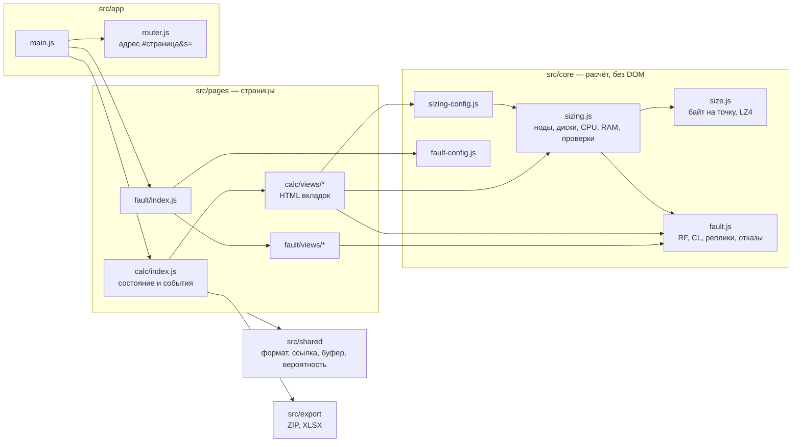

# Архитектура

Калькулятор поставляется одним HTML-файлом, который открывается в браузере без сервера и интернета. В репозитории лежат исходники этого файла, тесты и стенд проверки модели на Apache Cassandra 5.0.9. Почему выбран такой стек: [docs/adr/0001-stack.md](docs/adr/0001-stack.md).

## Принципы

1. **Один автономный файл.** Сборка склеивает JS, CSS и разметку в `dist/index.html`. Внешних запросов нет, это проверяет сборка.
2. **Нет зависимостей во время работы.** Только браузерный JavaScript (ES2020) без фреймворков. Зависимости разработки: esbuild, TypeScript (только проверка типов), Playwright.
3. **Расчёт отделён от интерфейса.** `src/core` не обращается к DOM и работает в Node: на нём держатся unit-тесты и регрессия.
4. **Представление — чистая функция.** `views/*.js` получают результат расчёта и возвращают HTML. Состояние и обработчики событий живут только в `pages/<страница>/index.js`.
5. **Страницы изолированы.** Стили каждой страницы вложены в `.pg-calc` или `.pg-fault`, `id` второй страницы начинаются с `ft-`, обработчики навешиваются на корень страницы. Общее: токены дизайна, `shared/`, `core/`.
6. **Один движок отказоустойчивости.** `core/fault.js` используют обе страницы.

## Слои



Зависимости направлены слева направо: `core` ничего не знает о страницах, страницы не знают друг о друге, `app` знает только интерфейс страниц (`mount`, `restore`).

## Поток данных

1. Пользователь меняет поле. Обработчик в `pages/<страница>/index.js` пишет значение в состояние страницы и откладывает пересчёт на 120–250 мс.
2. Пересчёт вызывает `core`: `sizing.compute(S)` или `fault.compute(state)`.
3. Результат передаётся в представления; HTML вставляется во вкладки.
4. Состояние кодируется в адрес (`shared/share.js`) и сохраняется через `app/router.js`: `#calc&s=…` или `#fault&s=…`. Первая страница дополнительно хранит ввод в `localStorage`.
5. Вероятность при случайных отказах считается кусками по 30 мс (`shared/prob.js`), интерфейс не блокируется.

## Карта файлов

### Корень

| Файл | Что это |
|---|---|
| `package.json` | Версия приложения (попадает в сборку), скрипты `build`, `typecheck`, `test:unit`, `test:e2e`, `check` |
| `package-lock.json` | Зафиксированные версии зависимостей разработки |
| `tsconfig.json` | Проверка типов JavaScript через `tsc --checkJs`, без генерации файлов |
| `playwright.config.js` | Сквозные проверки собранного файла в Chromium |
| `.nvmrc` | Версия Node.js для разработки и CI |
| `.github/dependabot.yml` | Ежемесячные pull request с обновлениями зависимостей разработки и actions |
| `.editorconfig`, `.gitignore` | Форматирование и исключения git |
| `ARCHITECTURE.md` | Этот документ |
| `CHANGELOG.md` | История изменений, Keep a Changelog |
| `LICENSE` | MIT |

### `src/app` — приложение

| Файл | Что делает |
|---|---|
| `main.js` | Точка входа. Монтирует страницу при первом показе, переключает страницы в шапке (мышь и стрелки), отдаёт `window.__app` для тестов |
| `router.js` | Адрес `#<страница>&s=<состояние>`: разбор, запись без перезагрузки, ссылки версии 2.0.x без имени страницы, вставка ссылки в адресную строку |
| `version.js` | Версия приложения; при сборке подставляется из `package.json` |

### `src/core` — расчёт (без DOM, работает в Node)

| Файл | Что делает |
|---|---|
| `size.js` | Размер строки `data_points` до сжатия по формату SSTable 5.0.9 и байт на точку после LZ4 16 КиБ по сетке замеров |
| `data/comp-grid.json` | Сетка сжатия LZ4: байт на точку по типу, варианту схемы, периоду, длине строки и аннотации. Источник: `verification/assemble.py` |
| `fault.js` | Топология DC/racks/нод, требования consistency level как `ConsistencyLevel.blockFor`, кольцо токенов, размещение реплик как `NetworkTopologyStrategy`, отказы нод, racks и DC, доли данных, вероятность при случайных отказах, замечания |
| `fault-config.js` | Файлы для страницы «Отказоустойчивость»: CQL keyspace, `cassandra.yaml` по DC, `cassandra-rackdc.properties` по нодам, конфигурация драйвера, команды проверки |
| `sizing.js` | Сайзинг: поток точек, объём на горизонте, три варианта схемы, RF и CL по требованиям, число нод, профили CPU/RAM, накопители и RAID, разбивка data-диска, калибровка по `nodetool tablestats`, проверки |
| `sizing-config.js` | Файлы для страницы «Системные требования»: `cassandra.yaml`, CQL, `cassandra-rackdc.properties`, драйвер C#, JVM, ОС, repair и мониторинг |
| `meta.js` | Версия Cassandra, под которую сверена модель |

### `src/pages/calc` — страница «Системные требования»

| Файл | Что делает |
|---|---|
| `template.html` | Разметка страницы: шапка с выгрузками, панель ввода, вкладки результата, окно «Что нового» |
| `calc.css` | Стили страницы, вложены в `.pg-calc` |
| `index.js` | Состояние ввода, обработчики полей и групп тегов, пересчёт, вкладки, схема отказов, выгрузки, печать |
| `state.js` | Значения по умолчанию, слияние с сохранённым вводом, `localStorage` для расчёта и сравнения |
| `exports.js` | ZIP конфигурации, книга Excel, сценарий JSON: возвращают байты, DOM не трогают |
| `views/common.js` | Названия вариантов, строка накопителей, список проверок, блок кода с подсветкой, кнопки ± |
| `views/summary.js` | Вкладка «Итог» |
| `views/disk.js` | Вкладка «Диски» |
| `views/fault.js` | Вкладка «Отказоустойчивость»: показатели, схема кластера, состояние при отказах, вероятность |
| `views/config.js` | Вкладка «Конфигурация» |
| `views/calibration.js` | Вкладка «Калибровка» |
| `views/method.js` | Вкладка «Методика» |
| `views/compare.js` | Вкладка «Сравнение» и сводка расчёта для неё |
| `views/print.js` | Отчёт для печати в PDF |

### `src/pages/fault` — страница «Отказоустойчивость»

| Файл | Что делает |
|---|---|
| `template.html` | Разметка страницы; все `id` начинаются с `ft-` |
| `fault.css` | Стили страницы, вложены в `.pg-fault`, цвета из общих токенов |
| `index.js` | Состояние, ввод топологии и CL, пересчёт, вкладки, схема отказов, копирование и скачивание конфигурации |
| `presets.js` | Типовые схемы |
| `views/common.js` | Проценты, текст переносимых отказов, ограничение целых |
| `views/summary.js` | Вкладка «Итог» |
| `views/failures.js` | Вкладка «Отказы»: худший случай, отказ DC, консистентность между DC, вероятность |
| `views/scheme.js` | Вкладка «Схема отказов» |
| `views/data.js` | Вкладка «Данные и нагрузка» |
| `views/config.js` | Вкладка «Конфигурация» |
| `views/method.js` | Вкладка «Методика» |

### `src/shared`, `src/export`, `src/styles`

| Файл | Что делает |
|---|---|
| `shared/format.js` | Числа, байты, проценты, склонение, экранирование HTML, дата для имён файлов |
| `shared/share.js` | Состояние в адресе: JSON → UTF-8 → base64url; совместим со ссылками 2.x |
| `shared/dom.js` | Уведомление, копирование в буфер с запасным путём, скачивание файла |
| `shared/prob.js` | Пересчёт вероятности кусками и график SVG для обеих страниц |
| `export/zip.js` | ZIP без сжатия (STORE) и CRC32 |
| `export/xlsx.js` | XLSX поверх `zip.js` |
| `styles/tokens.css` | Токены дизайна: цвета, шрифты, радиусы, цвета серий графика |
| `styles/base.css` | Сброс, глобальные правила, уведомление, печать |
| `styles/shell.css` | Шапка приложения |
| `styles/index.css` | Порядок подключения стилей |
| `index.html` | Каркас: шапка, контейнеры страниц, метки для сборки |
| `types.d.ts` | Объявления для проверки типов |

### `scripts`

| Файл | Что делает |
|---|---|
| `update-golden.mjs` | Пересоздаёт эталон регрессии текущим кодом, когда расчёт меняется намеренно |
| `build.mjs` | Собирает `dist/index.html`: esbuild для JS и CSS (вложенность CSS раскрывается под браузеры 2022+), вставка разметки страниц, проверка на внешние ресурсы и повторяющиеся `id`, бюджет 400 КБ. `--out` задаёт путь, `--dev` отключает минимизацию |

### `test`

| Файл | Что проверяет |
|---|---|
| `unit/size.test.js` | Размер строки против эталонной сериализации, vint, tombstone, LZ4 по сетке замеров |
| `unit/fault.test.js` | CL против независимой реализации `blockFor`, переносимые отказы, консистентность, наборы реплик против буквального переноса `calculateNaturalReplicas` на 60 топологиях, доли данных |
| `unit/sizing.test.js` | Сайзинг: RF, кратность нод стойкам, варианты схемы, линейность объёма, ручной расчёт, одна нода, ДЦ, своё железо, калибровка, конфигурация, мусор во вводе, скорость |
| `unit/regression.test.js` | 34 сценария обеих страниц совпадают с выпуском 2.1.0 до 12 значащих цифр, включая тексты конфигурации |
| `unit/views.test.js` | Все вкладки, печать и выгрузки строятся на всех сценариях без `undefined` и `NaN` |
| `unit/export.test.js` | CRC32, структура ZIP, части XLSX, экранирование |
| `unit/app.test.js` | Адрес, ссылка на расчёт, форматирование |
| `e2e/app.spec.js` | Переключение страниц, адрес у каждой страницы, старые ссылки, вставка ссылки без перезагрузки, клавиатура, печать |
| `e2e/calc.spec.js` | Сценарии первой страницы, схема отказов, калибровка, ZIP, Excel, JSON, ссылка, PDF |
| `e2e/fault.spec.js` | Типовые схемы, топология, ошибки ввода, схема отказов, вероятность, конфигурация, ссылка |
| `e2e/mobile.spec.js` | 390 px: нет горизонтальной прокрутки на всех вкладках |
| `e2e/text-snapshots.spec.js` | Тексты всех вкладок для расчёта по умолчанию; эталон совпадает с 2.1.0 |
| `e2e/__snapshots__/` | Эталонные тексты вкладок |
| `fixtures/scenarios.js` | Сценарии регрессии и проекция результата в JSON |
| `fixtures/golden-2.1.0.json.gz` | Эталон, снятый на коде 2.1.0 |
| `helpers/app.js`, `helpers/zip-reader.js` | Открытие приложения с перехватом ошибок консоли, чтение ZIP |

### `verification` — модель против Cassandra 5.0.9

Описание файлов и запуск: [verification/README.md](verification/README.md). Результаты: [verification/RESULTS.md](verification/RESULTS.md).

### `.github/workflows`

| Файл | Когда | Что делает |
|---|---|---|
| `ci.yml` | push в `main` и `release/**`, pull request, вызов из Release | Типы, unit-тесты, сборка с бюджетом, e2e в Chromium, артефакт `dist/index.html`; отдельно эталонная модель воспроизводит `rawcheck.json` и сетку сжатия |
| `release.yml` | Вручную, поле версии | Проверяет версию в `package.json`, CHANGELOG и заметки, прогоняет CI, собирает файл из исходников, ставит тег, публикует релиз с SHA-256 |
| `verify-cassandra.yml` | Вручную | Скачивает Cassandra 5.0.9, сверяет модель с `CQLSSTableWriter` и с запущенным сервером |

### `docs`

| Путь | Что это |
|---|---|
| `adr/` | Архитектурные решения |
| `releases/` | Заметки к релизам, публикуются workflow Release |
| `img/` | Изображения для README |

## Разработка

```bash
npm ci
npm run build          # dist/index.html
npm run typecheck
npm run test:unit
npx playwright install chromium   # один раз
npm run test:e2e
npm run check          # всё сразу, как в CI
```

`node scripts/build.mjs --dev` собирает без минимизации и с картой исходников.

### Типовые изменения

| Задача | Где менять | Что проверить |
|---|---|---|
| Формула расчёта | `src/core/*.js` | `npm run test:unit`. Если цифры меняются намеренно, обновить эталон регрессии и описать изменение в CHANGELOG |
| Новая сетка сжатия | `verification/measure.py`, `assemble.py` | `./verification/run.sh model`, затем `crossval` |
| Текст во вкладке | `src/pages/<страница>/views/*.js` | `npx playwright test text-snapshots --update-snapshots`, просмотреть diff снимков |
| Новая вкладка | `template.html`, `views/<вкладка>.js`, `index.js` страницы | e2e-проверка вкладки и мобильная ширина |
| Новая страница | `src/pages/<имя>/`, `src/index.html`, `src/app/main.js`, `src/styles/index.css` | Стили вложить в `.pg-<имя>`, `id` с префиксом страницы |
| Выпуск | `package.json` (версия), `CHANGELOG.md`, `docs/releases/vX.Y.Z.md` | Actions → Release → версия |

### Эталон регрессии

`test/fixtures/golden-2.1.0.json.gz` снят на коде 2.1.0. Когда расчёт меняется намеренно: `node scripts/update-golden.mjs <версия>`, затем заменить имя эталона в `test/unit/regression.test.js` и описать изменение цифр в CHANGELOG. Старый эталон остаётся в истории git.
