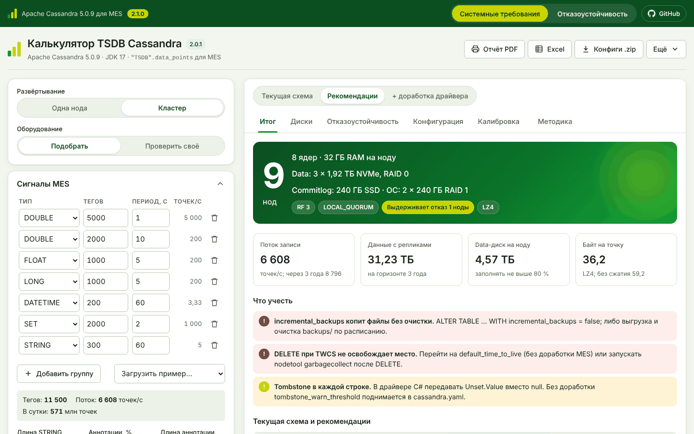
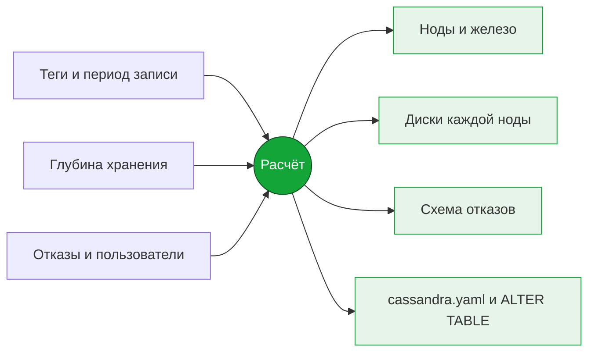
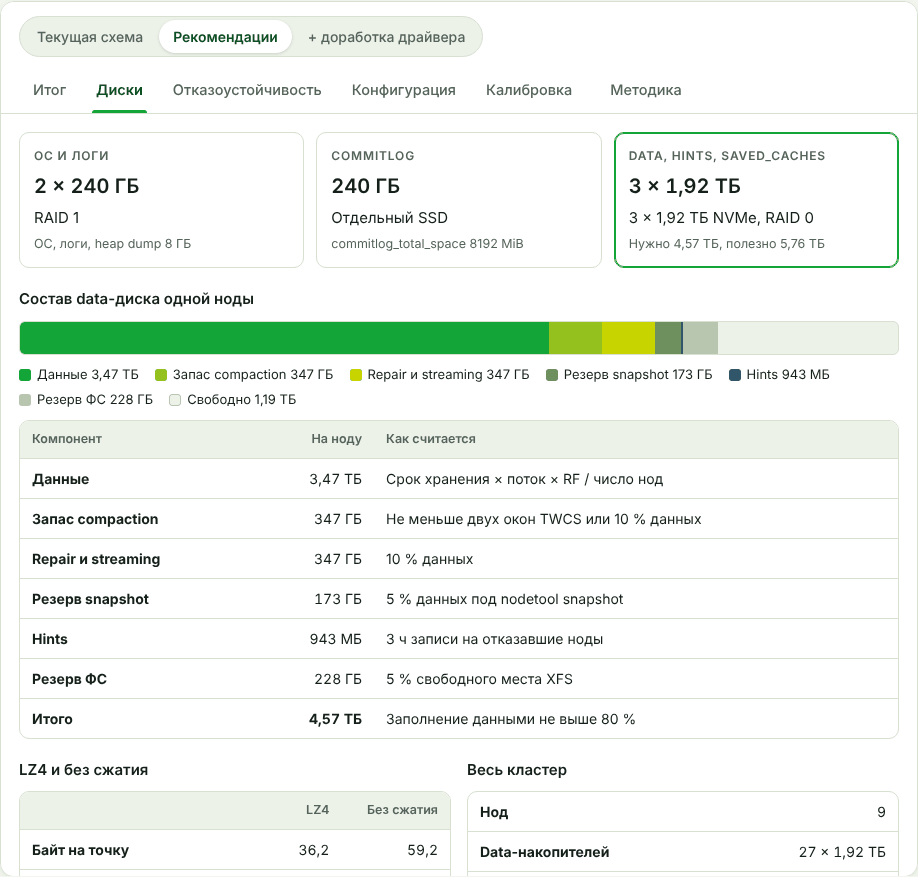
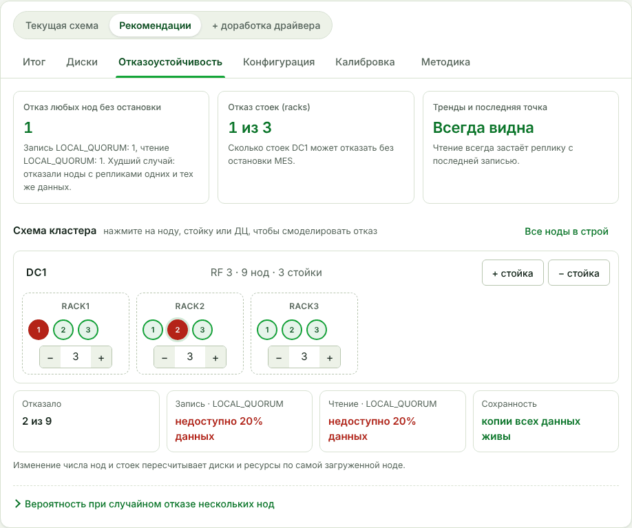
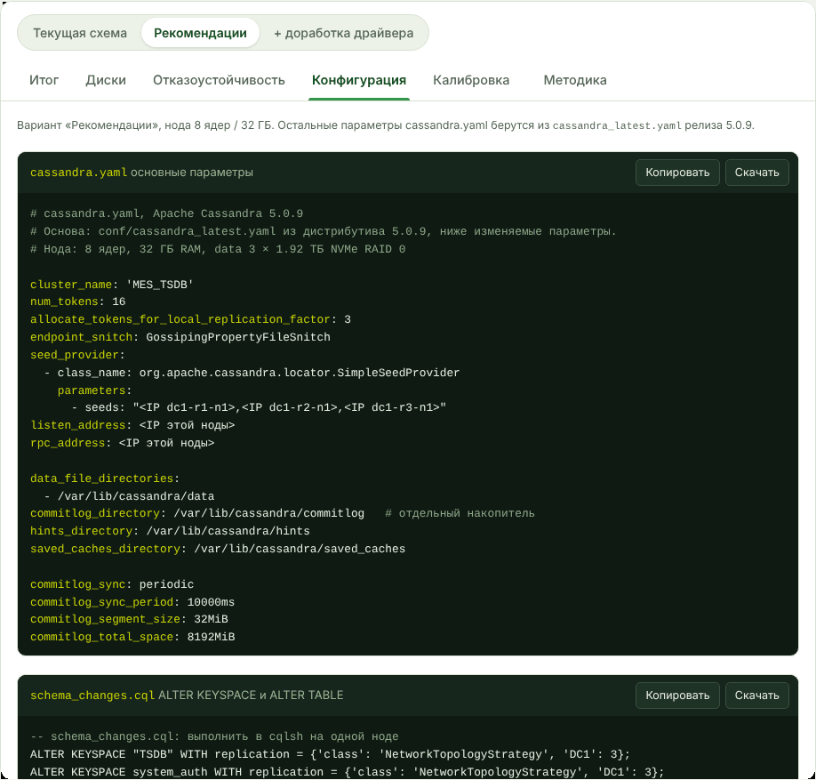
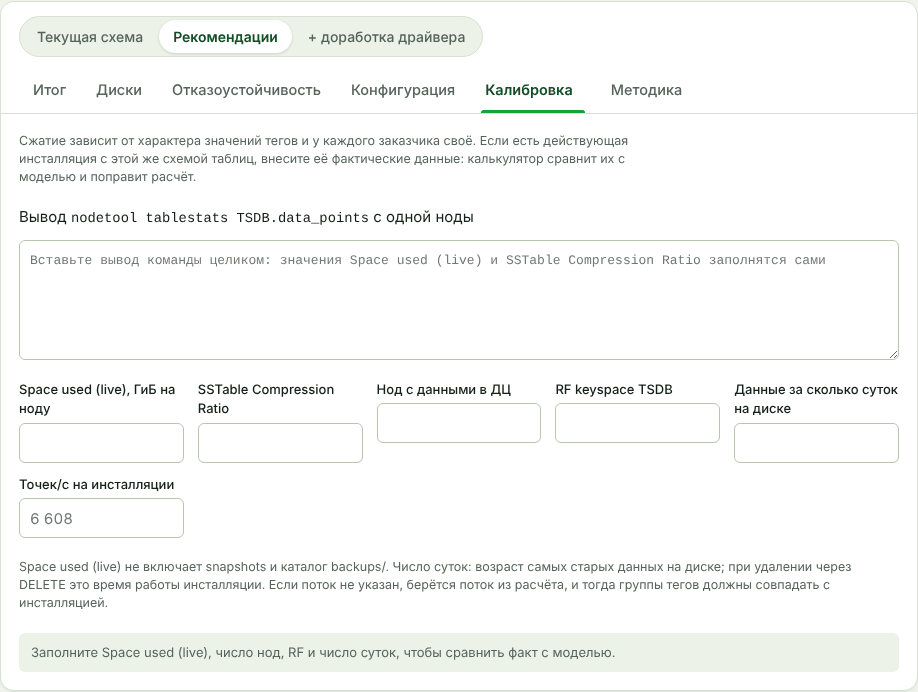
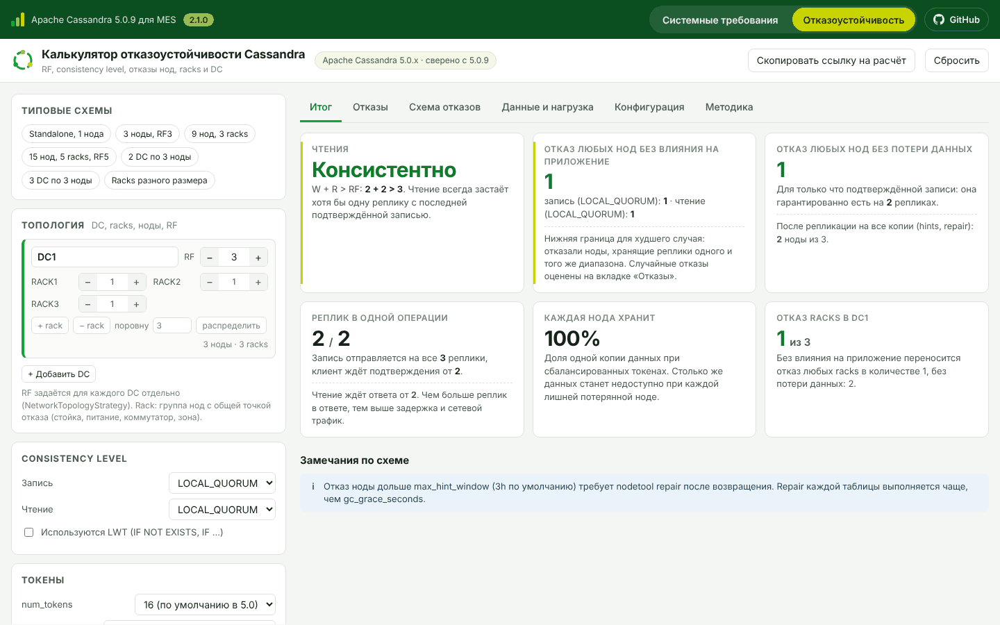
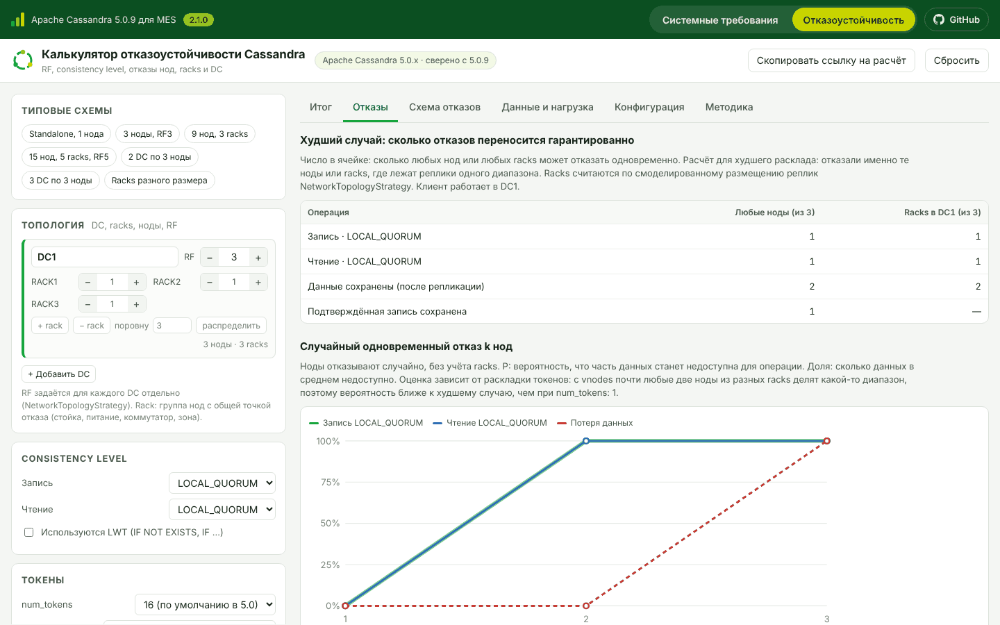
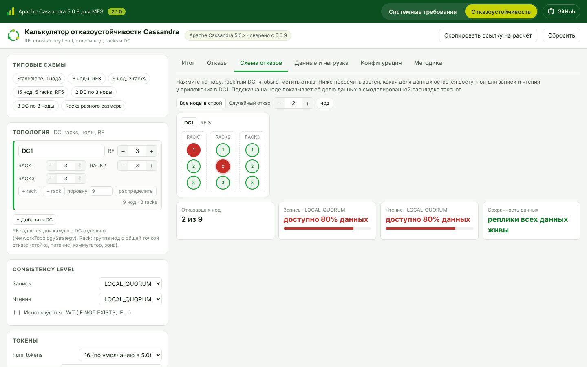
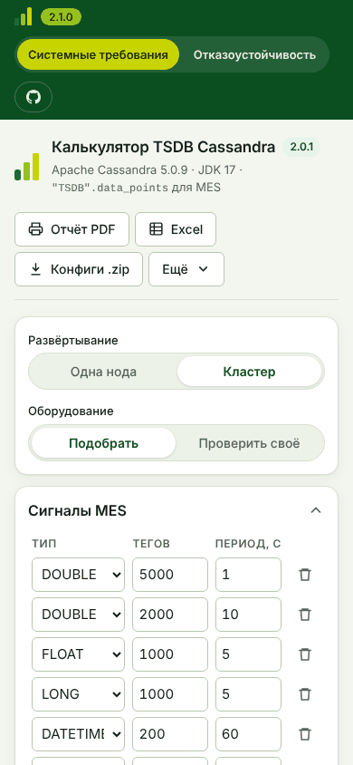

  

  
  
  
  
  

Два калькулятора Apache Cassandra 5.0 для MES-системы, которая хранит временные ряды в таблице `"TSDB".data_points`. Специалист внедрения получает медианную конфигурацию кластера для старта проекта и проектной документации и проверяет, как кластер переживёт отказы.

| Страница | Для чего |
|---|---|
| **[Системные требования](#страница-1-системные-требования)** | Сколько нод, какое железо и диски нужны под теги, глубину хранения и пользователей MES |
| **[Отказоустойчивость](#страница-2-отказоустойчивость)** | Сколько нод, стоек и ДЦ может отказать при выбранных RF и consistency level, и что при этом происходит с данными |

  

## Как пользоваться

1. Скачайте файл калькулятора из [последнего релиза](https://github.com/thesazonoff/cassandra-tsdb-calculator/releases/latest) и откройте в любом браузере. Сервер и интернет не нужны.
2. Вверху выберите страницу: «Системные требования» или «Отказоустойчивость».
3. Слева вводите данные, справа сразу видите результат.

Каждая страница помнит свой расчёт. Кнопка ссылки на расчёт даёт адрес, который откроет нужную страницу с теми же значениями. Кнопка «GitHub» вверху ведёт в этот репозиторий.

---

## Страница 1. Системные требования

Рассчитывает кластер под нагрузку MES: число нод, ядра, RAM, диски каждой ноды и готовую конфигурацию.

### Что вводится

| Раздел | Параметры |
|---|---|
| **Развёртывание** | Одна нода или кластер; подобрать оборудование или проверить своё |
| **Сигналы MES** | Группы тегов: тип (DOUBLE, FLOAT, LONG, DATETIME, SET, STRING), число тегов, период записи; длина строк и аннотаций |
| **Хранение** | Глубина в сутках, рост числа тегов, горизонт расчёта, сжатие LZ4 или без сжатия |
| **Отказоустойчивость** | Число дата-центров, сколько нод может отказать, нужны ли трендам всегда свежие данные |
| **Пользователи** | Сколько работают одновременно и как: редкие обращения, типовой режим, активная аналитика |
| **Инфраструктура** | NVMe, SATA SSD или HDD, RAID |

Параметры для архитектора (RF и consistency level вручную, стойки, `num_tokens`, SLA, сеть) свёрнуты в блоки «Дополнительно».

### Что выдаётся

| Вкладка | Что показывает |
|---|---|
| **Итог** | Число нод, ядра и RAM, диски, RF и consistency level, главные замечания, сравнение трёх вариантов схемы |
| **Диски** | Диски ОС, commitlog и data; из чего складывается объём data-диска; предельное заполнение; LZ4 против хранения без сжатия |
| **Отказоустойчивость** | Отказы рассчитанного кластера: стойки, схема с отключением нод, вероятность недоступности |
| **Конфигурация** | `cassandra.yaml`, `ALTER KEYSPACE` и `ALTER TABLE`, подключение из C#, `cassandra-rackdc.properties`, JVM и подготовка ОС |
| **Калибровка** | Сравнение расчёта с действующей инсталляцией по выводу `nodetool tablestats` и поправка расчёта |
| **Методика** | Размер точки на диске по типам данных и допущения расчёта |

Экспорт: отчёт PDF (через печать браузера), Excel, архив конфигов, сценарий `.json`.

<table>
  <tr>
    <td width="50%"> <b>Диски.</b> Объём на ноду по составляющим</td>
    <td width="50%"> <b>Отказоустойчивость.</b> Отказ двух нод в разных стойках</td>
  </tr>
  <tr>
    <td width="50%"> <b>Конфигурация.</b> Готовые фрагменты с кнопками «Копировать» и «Скачать»</td>
    <td width="50%"> <b>Калибровка.</b> Вставьте вывод nodetool tablestats</td>
  </tr>
</table>

### Три варианта схемы

| Вариант | Что меняется | Доработка MES |
|---|---|---|
| **Текущая схема** | Как сейчас: удаление через DELETE, `incremental_backups` включён, пустые колонки пишутся как `null` | Не нужна |
| **Рекомендации** | TTL таблицы вместо DELETE, окно TWCS под срок хранения, `incremental_backups` выключен | Не нужна |
| **+ доработка драйвера** | Драйвер C# передаёт `Unset.Value` вместо `null`: без 5 tombstone на каждую точку | Нужна |

Для примера по умолчанию (11 500 тегов, 365 суток, RF 3) рекомендации сокращают объём данных в 2,2 раза относительно текущей схемы, доработка драйвера ещё в 1,9 раза.

### Точность

- **Объём на диске** считается по формату строк SSTable Apache Cassandra 5.0.9 со сжатием LZ4. Модель сверена с официальным дистрибутивом: с SSTable, записанными кодом Cassandra, совпадение побайтное, на запущенном сервере отклонение не больше 0,12 %.
- **Сжатие** рассчитано на типовом профиле значений тегов. У конкретного заказчика оно может отличаться, поэтому есть вкладка «Калибровка».
- **Производительность и задержки** являются оценками и подтверждаются нагрузочным тестом.

---

## Страница 2. Отказоустойчивость

Отвечает на вопрос: сколько нод, стоек или целых ДЦ может отказать, чтобы MES продолжала писать и читать данные и ничего не потеряла. Подходит для любой топологии, не только той, что рассчитала первая страница.

  

### Что вводится

| Раздел | Параметры |
|---|---|
| **Типовые схемы** | Готовые варианты в один клик: одна нода; 3 ноды RF 3; 9 нод в 3 стойках; 15 нод в 5 стойках RF 5; 2 ДЦ по 3 ноды; 3 ДЦ по 3 ноды; стойки разного размера |
| **Топология** | До 5 ДЦ, у каждого свой RF и свои стойки с любым числом нод; кнопка «распределить» раскладывает ноды по стойкам поровну |
| **Consistency level** | Уровень для записи и чтения (все уровни Cassandra 5.0), ДЦ, в котором работает MES, LWT с serial consistency |
| **Токены** | `num_tokens` и способ выдачи токенов |
| **Данные и нагрузка** | Необязательно: объём одной копии данных, записей и чтений в секунду, размер записи |

### Что выдаётся

| Вкладка | Что показывает |
|---|---|
| **Итог** | Будет ли чтение видеть последнюю запись; сколько любых нод может отказать без влияния на MES и без потери данных; сколько реплик участвует в операции; доля данных на ноду; сколько стоек может отказать; замечания по схеме |
| **Отказы** | Худший случай по нодам и по стойкам каждого ДЦ; отказ целого ДЦ; согласованность при записи в одном ДЦ и чтении в другом; график вероятности, что часть данных станет недоступна при случайном отказе 1, 2, 3… нод |
| **Схема отказов** | Схема кластера по ДЦ и стойкам: щелчок по ноде, стойке или ДЦ «выключает» их, и сразу видно, какая доля данных доступна для записи и чтения и не потеряны ли данные; кнопка случайного отказа заданного числа нод |
| **Данные и нагрузка** | Доля данных, объём и операции на каждую ноду, перекосы при стойках разного размера |
| **Конфигурация** | `cassandra.yaml`, `cassandra-rackdc.properties` на каждую ноду, `schema.cql` с репликацией, `application.conf` для Java-драйвера 4.x |
| **Методика** | Формулы и правила, по которым считается результат |

<table>
  <tr>
    <td width="50%"> <b>Отказы.</b> Худший случай и вероятность при случайных отказах</td>
    <td width="50%"> <b>Схема отказов.</b> Отказали две ноды в разных стойках из девяти</td>
  </tr>
</table>

Размещение реплик повторяет `NetworkTopologyStrategy` из Cassandra 5.0.9, требования consistency level взяты из её исходного кода. Для небольших кластеров вероятность считается точным перебором сочетаний, для больших методом Монте-Карло.

---

## На телефоне

Обе страницы работают и на телефоне: поля и вкладки перестраиваются в одну колонку, широкие таблицы прокручиваются внутри своего блока.

Подходит, чтобы быстро прикинуть конфигурацию на встрече с заказчиком.

 

## Версии

Расчёт ориентирован на Apache Cassandra 5.0.9 и JDK 17. История изменений: [CHANGELOG.md](CHANGELOG.md).
