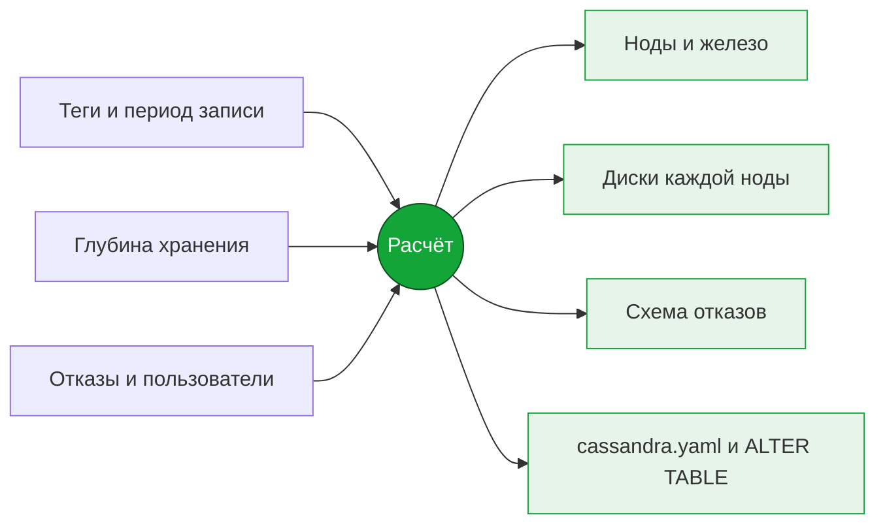

  

  
  
  
  
  

Калькулятор системных требований Apache Cassandra 5.0 для MES-системы, которая хранит временные ряды в таблице `"TSDB".data_points`. Специалист внедрения вводит теги, глубину хранения и требования к отказоустойчивости и получает медианную конфигурацию кластера для старта проекта и проектной документации.

  

## Как пользоваться

1. Скачайте [`index.html`](index.html) и откройте в любом браузере. Сервер и интернет не нужны.
2. Слева введите сигналы MES, глубину хранения, допустимые отказы, число пользователей и тип дисков.
3. Справа сразу появится результат. Выгрузите его в PDF, Excel или архив конфигов.

Введённые значения сохраняются в браузере. Расчётом можно поделиться ссылкой или файлом сценария `.json`.

## Что вводится

| Раздел | Параметры |
|---|---|
| **Развёртывание** | Одна нода или кластер; подобрать оборудование или проверить своё |
| **Сигналы MES** | Группы тегов: тип (DOUBLE, FLOAT, LONG, DATETIME, SET, STRING), число тегов, период записи; длина строк и аннотаций |
| **Хранение** | Глубина в сутках, рост числа тегов, горизонт расчёта, сжатие LZ4 или без сжатия |
| **Отказоустойчивость** | Число дата-центров, сколько нод может отказать, нужны ли трендам всегда свежие данные |
| **Пользователи** | Сколько работают одновременно и как: редкие обращения, типовой режим, активная аналитика |
| **Инфраструктура** | NVMe, SATA SSD или HDD, RAID |

Параметры для архитектора (RF и consistency level вручную, стойки, `num_tokens`, SLA, сеть) свёрнуты в блоки «Дополнительно».

## Что выдаётся

| Вкладка | Что показывает |
|---|---|
| **Итог** | Число нод, ядра и RAM, диски, RF и consistency level, главные замечания, сравнение трёх вариантов схемы |
| **Диски** | Диски ОС, commitlog и data; из чего складывается объём data-диска; предельное заполнение; LZ4 против хранения без сжатия |
| **Отказоустойчивость** | Сколько нод и стоек может отказать; схема кластера, где можно «выключить» ноду, стойку или ДЦ; вероятность недоступности при случайных отказах |
| **Конфигурация** | `cassandra.yaml`, `ALTER KEYSPACE` и `ALTER TABLE`, подключение из C#, `cassandra-rackdc.properties`, JVM и подготовка ОС |
| **Калибровка** | Сравнение расчёта с действующей инсталляцией по выводу `nodetool tablestats` и поправка расчёта |
| **Методика** | Размер точки на диске по типам данных и допущения расчёта |

<table>
  <tr>
    <td width="50%"> <b>Диски.</b> Объём на ноду по составляющим</td>
    <td width="50%"> <b>Отказоустойчивость.</b> Отказ двух нод в разных стойках</td>
  </tr>
  <tr>
    <td width="50%"> <b>Конфигурация.</b> Готовые фрагменты с кнопками «Копировать» и «Скачать»</td>
    <td width="50%"> <b>Калибровка.</b> Вставьте вывод nodetool tablestats</td>
  </tr>
</table>

## Три варианта схемы

| Вариант | Что меняется | Доработка MES |
|---|---|---|
| **Текущая схема** | Как сейчас: удаление через DELETE, `incremental_backups` включён, пустые колонки пишутся как `null` | Не нужна |
| **Рекомендации** | TTL таблицы вместо DELETE, окно TWCS под срок хранения, `incremental_backups` выключен | Не нужна |
| **+ доработка драйвера** | Драйвер C# передаёт `Unset.Value` вместо `null`: без 5 tombstone на каждую точку | Нужна |

Для примера по умолчанию (11 500 тегов, 365 суток, RF 3) рекомендации сокращают объём данных в 2–2,5 раза относительно текущей схемы, доработка драйвера ещё примерно вдвое.

## Точность

- **Объём на диске** считается по формату строк SSTable Apache Cassandra 5.0.9 со сжатием LZ4. Модель сверена с официальным дистрибутивом: с SSTable, записанными кодом Cassandra, совпадение побайтное, на запущенном сервере отклонение не больше 0,12 %.
- **Сжатие** рассчитано на типовом профиле значений тегов. У конкретного заказчика оно может отличаться, поэтому есть вкладка «Калибровка».
- **Производительность и задержки** являются оценками и подтверждаются нагрузочным тестом.

## На телефоне

Калькулятор работает и на телефоне: поля и вкладки перестраиваются в одну колонку, широкие таблицы прокручиваются внутри своего блока.

Подходит, чтобы быстро прикинуть конфигурацию на встрече с заказчиком.

 

## Версии

Расчёт ориентирован на Apache Cassandra 5.0.9 и JDK 17. История изменений: [CHANGELOG.md](CHANGELOG.md).
